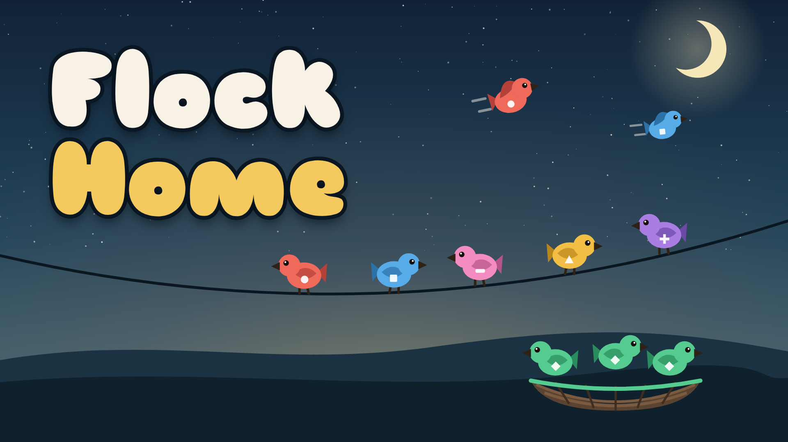

# Flock Home

A hybrid-casual puzzle game for the web. Birds sit on a grid, each facing one way. Tap a bird and it flies off if nothing is in its way, heading for the nest of its colour. If that nest isn't open yet, the bird waits on the wire. Fill every perch on the wire and the level is lost.

The first target is [CrazyGames](https://www.crazygames.com/). See [docs/ROADMAP.md](docs/ROADMAP.md) for the plan and the decision points.



## Run it

No build tools or frameworks are needed: the game is one HTML file.

```bash
npm install        # only needed for the cover font
npm test           # engine tests (node:test)
npm run build      # writes dist/index.html (upload this) and dist/artifact.html
npm run sim 1 40   # difficulty report for levels 1–40
```

Open `dist/index.html` in a browser to play.

## Repository layout

| Path | What it is |
|---|---|
| `src/engine.js` | Pure game rules, level generator and hint solver. No DOM. Runs in the browser and in Node. |
| `src/game.html` | The game page: layout, styles, rendering, input, sound, boosters, ad placeholders. The build inlines the engine at `/*ENGINE*/`. |
| `tools/build.mjs` | Produces `dist/index.html` (full document for CrazyGames) and `dist/artifact.html` (fragment for the playtest page). |
| `tools/sim.mjs` | Plays generated levels with simple bots and prints win rates, to check the difficulty curve. |
| `tools/covers/` | Cover image source (`cover.html`) and renderer (`render.py`). |
| `tests/` | Engine tests. |
| `assets/covers/` | Rendered cover images for the CrazyGames submission. |
| `docs/` | Roadmap, game design, market research, CrazyGames checklist, and architecture decisions (`docs/adr/`). |

## For AI agents

Read [AGENTS.md](AGENTS.md) before changing anything.
